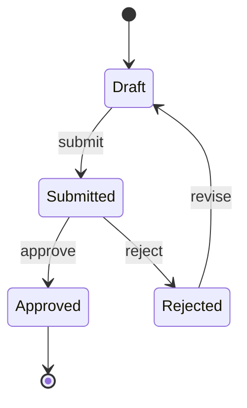

# Product State Model

Status: Draft

Delete this file only when the product has no meaningful lifecycle state. Every
transition should name its trigger, permissions, side effects, and failure rule.

## Transition rules

| From | Trigger | To | Who | Preconditions | Side effects | Failure behavior |
|---|---|---|---|---|---|---|

