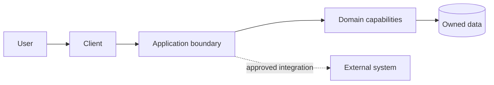

# System Context and Components

Status: Draft

Use product/domain names, not vague labels. Mark trust boundaries, external
systems, data ownership, and synchronous versus asynchronous communication.

## Boundary notes

- Owned components:
- External systems:
- Sensitive data and trust boundaries:
- Runtime/deployment boundaries:
- Failure isolation and fallback:

