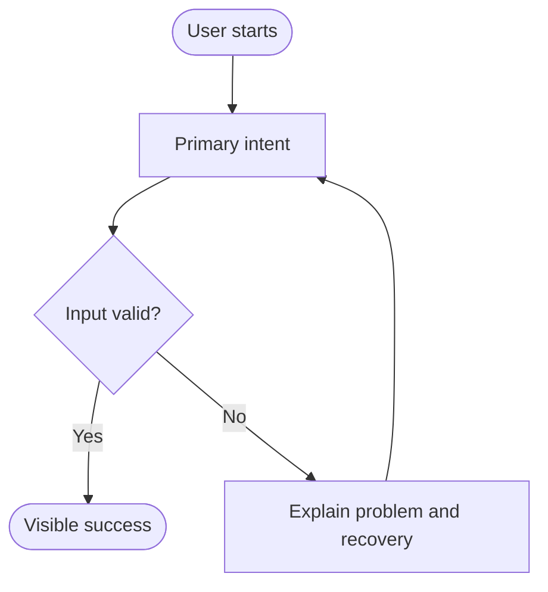

# User Flow

Status: Draft

Replace the example after requirements are approved. Show the happy path,
important alternatives, permission denial, validation failure, and recovery.

## Flow rules

- Entry conditions:
- Exit conditions:
- Permission rules:
- Failure and recovery:

